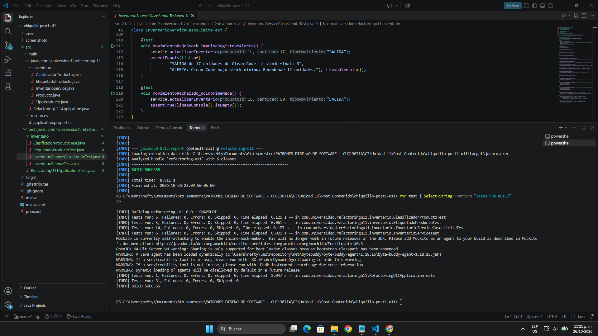
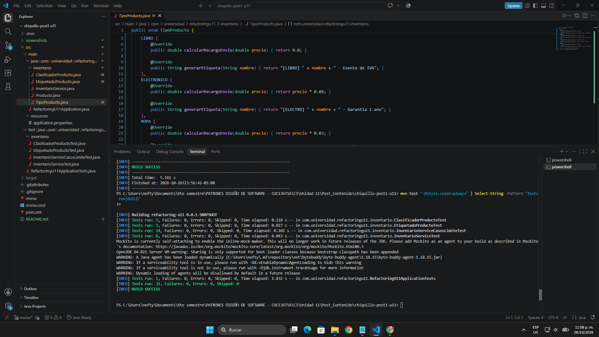

# Post-contenido — Unidad 11: Refactorización Guiada por Pruebas

## Descripción

Repositorio del post-contenido de la Unidad 11 de Patrones de Diseño de Software. Contiene un único proyecto Maven con Spring Boot (`refactoring-u11`) en la raíz, trabajado como un kata de refactorización guiada por pruebas: primero se documenta con pruebas lo que el código hace hoy y solo después se cambia su estructura, verificando en cada paso que el comportamiento observable no cambie.

El proyecto tiene dos partes: la **Parte 1** elimina dos code smells de un servicio de inventario (un Long Method y un Switch Statement duplicado en dos clases); la **Parte 2** agrega un módulo de reportes, detecta con una prueba de arquitectura la dependencia cíclica que introduce entre paquetes y la resuelve invirtiendo la dependencia.

---

## Parte 1 — Code Smells en el Servicio de Inventario

### 1. Diagnóstico con evidencia (código original)

Las líneas citadas corresponden al commit `9f5752b`, donde está el código tal como lo entrega el enunciado. Las métricas de complejidad y cobertura se midieron con JaCoCo.

#### Long Method en `InventarioService.actualizarInventario()`

El método ocupa **44 líneas** (19 a 62) y mezcla cinco responsabilidades en un solo bloque:

| Responsabilidad | Líneas | Qué hace |
|-----------------|--------|----------|
| Validación de entrada | 21-25 | Revisa `productoId`, `cantidad` y que `tipoMovimiento` sea `ENTRADA` o `SALIDA` |
| Búsqueda del producto | 27-32 | Recorre la lista con un `for` y un `break` |
| Actualización de stock | 34-42 | Suma o resta según el tipo y rechaza un stock negativo en `SALIDA` |
| Cálculo de reorden | 44-47 | `stockMinimo * 3 - nuevoStock` cuando el stock queda bajo el mínimo |
| Registro y alerta | 49-61 | Arma el texto del movimiento, lo guarda, lo imprime y decide la alerta |

- **Complejidad ciclomática: 13** según JaCoCo (la guía, sección 7.3, pone la meta en CC ≤ 10). Contando a mano sobre el código fuente salen 11 decisiones: el `if` de validación con sus tres operadores (`||`, `||`, `&&`), el `for`, los `if` de búsqueda, de producto nulo, de tipo `ENTRADA` y de stock negativo, el ternario de la reorden y el `if` de la alerta. JaCoCo suma una más porque la comparación `nuevoStock < producto.getStockMinimo()` se compila como un salto condicional.
- **Cobertura: 0 %**, porque el proyecto no traía pruebas.
- El propio método necesita comentarios de encabezado para separar sus partes, algo que la guía (sección 6.3) señala como síntoma de que el método hace demasiado.

#### Switch Statements duplicados en `ClasificadorProducto` y `EtiquetadoProducto`

Las dos clases tienen un `switch` sobre `TipoProducto` en las líneas 7-14, con las mismas cuatro ramas en el mismo orden (`LIBRO`, `ELECTRONICO`, `ROPA`, `ALIMENTO`) y el mismo `default`:

- **Duplicación estructural del 100 %**: mismas ramas, mismo orden y mismo `default`; lo único que cambia es la expresión después de cada `return`.
- **Duplicación textual del 50 %**: de las 8 líneas de cada `switch`, 4 son idénticas carácter por carácter (`switch (producto.getTipo()) {`, las dos líneas del `default` y la llave de cierre).
- **Complejidad ciclomática de 5** en `calcularRecargoEnvio` y en `generarEtiqueta`.
- **La rama `default` es código muerto**: JaCoCo la reporta sin cubrir (4 de 5 ramas) aun probando los cuatro tipos, porque con un enum de cuatro valores es inalcanzable; un producto con tipo `null` lanza `NullPointerException` en el `switch` antes de llegar a ella.
- **Riesgo de cambio (Shotgun Surgery)**: agregar un tipo de producto obliga a acordarse de editar las dos clases. Si se olvida una, el error solo aparece en ejecución, en el `default`.

### 2. Red de seguridad: pruebas de caracterización

Antes de modificar una sola línea de `InventarioService`, `ClasificadorProducto` o `EtiquetadoProducto` se escribieron las pruebas y se ejecutaron en verde sobre el código original (commit `54f5f94`). Se instancian con `new`, sin levantar Spring, para que sean rápidas.

| Clase de prueba | Pruebas | Qué documenta |
|-----------------|---------|---------------|
| `InventarioServiceTest` | 6 | Las del enunciado: OK, error de datos, error de stock, alerta de reorden y producto inexistente |
| `InventarioServiceCasosLimiteTest` | 14 | Casos límite agregados (ver abajo) |
| `ClasificadorProductoTest` | 5 | Las cuatro ramas del recargo y el tipo `null` |
| `EtiquetadoProductoTest` | 5 | Las cuatro ramas de la etiqueta y el tipo `null` |
| `RefactoringU11ApplicationTests` | 1 | Que el contexto de Spring arranque (generada por Spring Initializr) |

Las pruebas del enunciado se copiaron tal cual, pero tenían dos vacíos frente a su propio checkpoint y a la rúbrica, y se cerraron en este mismo paso:

1. **`EtiquetadoProductoTest` solo probaba `LIBRO` y `ELECTRONICO`**, mientras el checkpoint pide cubrir "las cuatro ramas del switch en ambas clases". Se agregaron `ROPA` y `ALIMENTO`.
2. **Faltaban casos límite.** `InventarioServiceCasosLimiteTest` fija: `productoId` nulo, cantidad cero, `"entrada"` en minúscula, `tipoMovimiento` nulo (lanza `NullPointerException`), que la validación ocurre antes de buscar el producto, stock que queda igual al mínimo (no hay reorden), salida de todo el stock, reorden después de una `ENTRADA`, varios productos en la lista y **lo que se imprime en consola** (registro y alerta), porque esos mensajes también son comportamiento observable y el refactor los cambia de lugar.

Dos de esas pruebas documentan un comportamiento que **no es correcto pero es el actual**: una `ENTRADA` con cantidad negativa resta stock y una `SALIDA` con cantidad negativa lo suma. Una prueba de caracterización no corrige el código, lo describe (guía, sección 7.2); arreglarlo sería un cambio de comportamiento y no le corresponde a un refactor.

Resultado: **31 pruebas, 0 fallos** sobre el código original, y `InventarioService` con el **100 % de líneas y ramas** cubiertas.



### 3. Refactorización del Long Method

Se hizo en dos commits, uno por técnica, como pide el protocolo de la guía (sección 7.1), ejecutando `mvn test` después de cada cambio:

1. **Move Method** (commit `d84dccf`): el cálculo de reorden pasó a `Producto` como `necesitaReorden()` y `calcularCantidadReorden()`. Ver *Decisión de diseño 1*.
2. **Extract Method con una guard clause** (commit `594a634`): cada responsabilidad pasó a un método privado con nombre propio, y la búsqueda devuelve un `Optional<Producto>` en lugar de un `null`, como recomienda la guía (sección 6.4).

```java
public String actualizarInventario(Long productoId, int cantidad, String tipoMovimiento) {
    if (!sonDatosValidos(productoId, cantidad, tipoMovimiento)) return "ERROR_DATOS_INVALIDOS";
    return buscarProducto(productoId)
            .map(producto -> aplicarMovimiento(producto, cantidad, tipoMovimiento))
            .orElse("ERROR_PRODUCTO_NO_EXISTE");
}
```

| Métrica | Antes | Después |
|---------|-------|---------|
| Líneas de `actualizarInventario()` | 44 | 6 |
| Complejidad ciclomática de `actualizarInventario()` | 13 | 2 |
| CC más alta entre los métodos extraídos | — | 4 (`sonDatosValidos`, `aplicarMovimiento`) |
| Responsabilidades por método | 5 | 1 |

| Método extraído | Responsabilidad |
|-----------------|-----------------|
| `sonDatosValidos` / `esTipoMovimientoValido` | Validación de entrada |
| `buscarProducto` | Búsqueda por id |
| `aplicarMovimiento` | Orquestar el movimiento sobre un producto ya encontrado |
| `calcularNuevoStock` | Sumar o restar según el tipo |
| `registrarMovimiento` | Guardar e imprimir el registro |
| `alertarReorden` | Imprimir la alerta y armar el código de respuesta |
| `Producto.necesitaReorden` / `Producto.calcularCantidadReorden` | Regla de reorden del producto |

**Un hallazgo durante el refactor:** la primera versión de `sonDatosValidos` evaluaba `tipoMovimiento.equals(...)` antes de revisar `productoId`. En el original, el `||` corta en `productoId == null`, de modo que `actualizarInventario(null, 5, null)` devuelve `ERROR_DATOS_INVALIDOS`; con el orden cambiado lanzaba `NullPointerException`. **Ninguna de las 31 pruebas cubre ese caso**, así que la suite habría seguido en verde. Se detectó revisando la equivalencia línea por línea y se corrigió respetando el orden original. Lo mismo pasa con el stock negativo: el original solo lo rechaza en `SALIDA`, y una `ENTRADA` con cantidad negativa grande deja el stock en negativo sin error; esa asimetría se conservó a propósito. La conclusión es que las pruebas de caracterización son la red de seguridad, pero no reemplazan leer el código que se está moviendo.

### 4. Refactorización del Switch Statement duplicado

Se aplicó **Replace Conditional with Polymorphism** (guía, sección 3.1) sobre el propio enum: `TipoProducto` declara un método abstracto por comportamiento y cada constante lo implementa. Las dos clases quedan delegando en el tipo, con su firma original intacta:

```java
public enum TipoProducto {
    LIBRO {
        @Override
        public double calcularRecargoEnvio(double precio) { return 0.0; }

        @Override
        public String generarEtiqueta(String nombre) { return "[LIBRO] " + nombre + " - Exento de IVA"; }
    },
    // ELECTRONICO, ROPA y ALIMENTO igual, cada uno con sus dos implementaciones
    ;
    public abstract double calcularRecargoEnvio(double precio);
    public abstract String generarEtiqueta(String nombre);
}

public double calcularRecargoEnvio(Producto producto) {        // ClasificadorProducto
    return producto.getTipo().calcularRecargoEnvio(producto.getPrecio());
}

public String generarEtiqueta(Producto producto) {             // EtiquetadoProducto
    return producto.getTipo().generarEtiqueta(producto.getNombre());
}
```

| Métrica | Antes | Después |
|---------|-------|---------|
| `switch` sobre `TipoProducto` en el proyecto | 2 (con 4 ramas cada uno) | 0 |
| CC de `calcularRecargoEnvio` / `generarEtiqueta` | 5 / 5 | 1 / 1 |
| Rama `default` inalcanzable | 2 (una por clase) | 0 |
| Clases que hay que editar para agregar un tipo | 2 (`ClasificadorProducto` y `EtiquetadoProducto`) | 1 (`TipoProducto`) |
| Si se olvida un comportamiento para un tipo nuevo | Error en ejecución, en el `default` | **No compila** |

Una búsqueda de `switch`, `case` o comparaciones con constantes de `TipoProducto` en `src/main` no devuelve ningún resultado.

Los métodos de enum reciben el precio o el nombre, no el `Producto` completo: cada comportamiento pide solo el dato que usa, y así `TipoProducto` no depende de `Producto` (la dependencia va en un solo sentido, de `Producto` hacia su tipo).

### 5. Resultado de `mvn test` en cada paso

Las pruebas no se modificaron en ningún paso: `git diff` sobre `src/test` sale vacío desde el commit `54f5f94`.

| Momento | Commit | Pruebas | Resultado |
|---------|--------|---------|-----------|
| Código original con las pruebas de caracterización | `54f5f94` | 31 | 31 en verde |
| Después de Move Method (reorden en `Producto`) | `d84dccf` | 31 | 31 en verde |
| Después de Extract Method (Long Method eliminado) | `594a634` | 31 | 31 en verde |
| Después de eliminar el switch duplicado | `8105258` | 31 | 31 en verde |



---

## Cómo ejecutar

Requisitos: Java 17 o superior y Maven 3.9+ (o el wrapper incluido).

```bash
mvn test                                    # suite completa
mvn test -Dtest=InventarioServiceTest       # una sola clase de prueba
```

> En Windows con el wrapper: `.\mvnw.cmd test`.

Para reproducir las métricas de complejidad y cobertura citadas en este README (reporte en `target/site/jacoco/index.html`):

```bash
mvn clean org.jacoco:jacoco-maven-plugin:0.8.12:prepare-agent test org.jacoco:jacoco-maven-plugin:0.8.12:report
```

---

## Herramientas utilizadas

- Java 17, Spring Boot 4.1.2 (Spring Boot Starter), JUnit 5
- JaCoCo 0.8.12 (complejidad ciclomática y cobertura)
- Apache Maven, Git, GitHub, Visual Studio Code

---

## Decisiones de diseño

### Decisión de diseño 1 — Cálculo de la cantidad de reorden: ¿método privado o clase propia?

**Decisión:** ninguna de las dos. El cálculo pasó a la propia entidad `Producto`, con **Move Method** (guía, sección 2.3): `producto.necesitaReorden()` y `producto.calcularCantidadReorden()`. `InventarioService` solo pregunta y no calcula.

**Por qué:** la fórmula `stockMinimo * 3 - stock` usa únicamente datos de `Producto` (su stock y su stock mínimo) y ningún dato del servicio. En el original, `InventarioService` leía dos veces `producto.getStockMinimo()` y lo combinaba con el stock que acababa de asignarle al mismo producto, es decir, calculaba por fuera algo que es del producto: es **Feature Envy**, y la guía da como criterio que, si la mayoría de las referencias de un método son a otra clase, ese método pertenece a esa otra clase. Es el mismo criterio que deja la regla en la entidad cuando no necesita ningún colaborador externo (repositorio, otro servicio, configuración).

**Alternativas descartadas:**

- **Método privado en `InventarioService`:** quita líneas del método largo, pero deja la regla en el lugar equivocado. El servicio seguiría pidiéndole datos a `Producto` para hacer el cálculo por fuera, y cualquier otra clase que necesitara saber si un producto requiere reorden (por ejemplo, el módulo de reportes de la Parte 2) tendría que duplicar la fórmula o pasar por el servicio.
- **Clase `CalculadoraReorden`:** se justificaría si la política de reorden tuviera una razón de cambio propia, por ejemplo si dependiera del proveedor o de una configuración. Hoy es una sola expresión sin colaboradores, así que una clase solo para eso sería una **Lazy Class** y una abstracción para un caso que no existe (**Speculative Generality**, guía, sección 1.4).

**Lo que se sacrifica:** si mañana la política de reorden dependiera de algo externo (un proveedor, un parámetro de configuración), ya no cabría en `Producto`, porque la entidad no debe conocer servicios. En ese momento sí convendría extraer una clase. Mientras sea una regla del propio producto, su lugar es la entidad.

### Decisión de diseño 2 — Mecanismo de polimorfismo: ¿enum con métodos abstractos o interfaz Strategy?

**Decisión:** enum con un método abstracto por comportamiento (`calcularRecargoEnvio` y `generarEtiqueta`), implementado en cada constante de `TipoProducto`. **Alternativa descartada:** una interfaz de estrategia con una clase por tipo de producto.

**Justificación:** (1) el conjunto de tipos es cerrado y estable en este dominio: `TipoProducto` ya era un enum de cuatro valores y lo que cambia por tipo es una función pura del precio o del nombre, sin datos externos; (2) el compilador obliga a que toda constante nueva implemente los dos métodos abstractos, de modo que olvidar un comportamiento ya no es un error en ejecución en el `default` sino un error de compilación; (3) agregar un tipo toca un solo archivo, `TipoProducto`, y ni `ClasificadorProducto` ni `EtiquetadoProducto` cambian, que es la condición no negociable del Paso 4. Con Strategy habría hecho falta una interfaz, cuatro clases como mínimo y además un `Map` o registro que relacione cada `TipoProducto` con su estrategia, y ese registro sería un tercer lugar que actualizar por cada tipo nuevo.

**Lo que se sacrifica:** las constantes de un enum no pueden recibir beans de Spring por inyección. Si en el futuro un tipo necesitara un colaborador (por ejemplo, consultar una tarifa de envío en un servicio externo), habría que migrar a la interfaz Strategy con una clase `@Component` por tipo, y ese costo de una jerarquía adicional se pagaría entonces. Además, `ClasificadorProducto` y `EtiquetadoProducto` quedan como clases de una sola línea que delegan en el tipo, cerca de un **Middle Man** (guía, sección 1.5). Se conservan porque el checkpoint exige mantener sus firmas y porque son el punto de entrada que ya usan sus pruebas; si nadie más las necesitara, el siguiente paso sería llamar directamente a `producto.getTipo()`.

---

## Conclusiones

La Parte 1 mostró que escribir las pruebas antes de tocar el código no es un trámite: con 31 pruebas en verde se pudo bajar `actualizarInventario()` de 44 líneas y CC 13 a 6 líneas y CC 2, y quitar los dos `switch` duplicados, sin modificar ni una prueba. Las dos decisiones salieron de la misma pregunta, a quién le pertenece cada dato: la regla de reorden terminó en `Producto` porque solo usa datos del producto, y el comportamiento por tipo terminó en `TipoProducto` porque el conjunto de tipos es cerrado y así el compilador avisa si falta algo. También quedó claro el límite de la red de seguridad: el caso `(null, 5, null)` cambiaba de comportamiento sin que ninguna prueba fallara, así que las pruebas protegen lo que cubren y lo demás hay que revisarlo leyendo el código.
