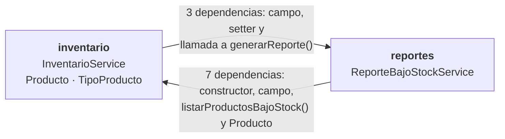
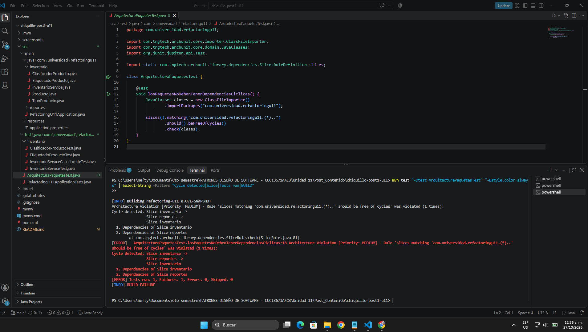
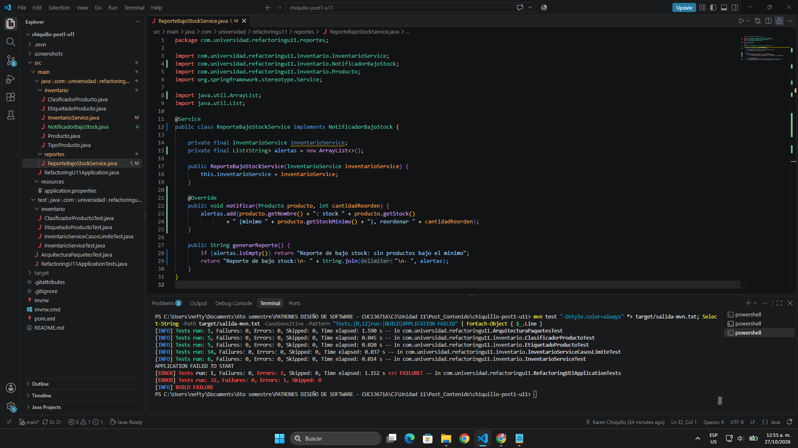
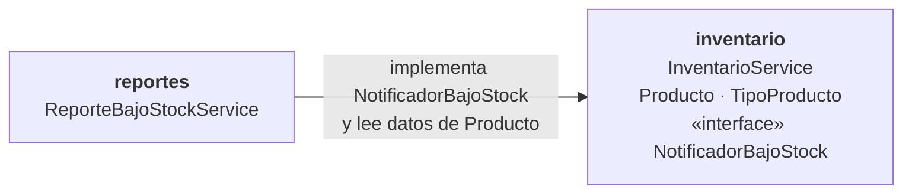
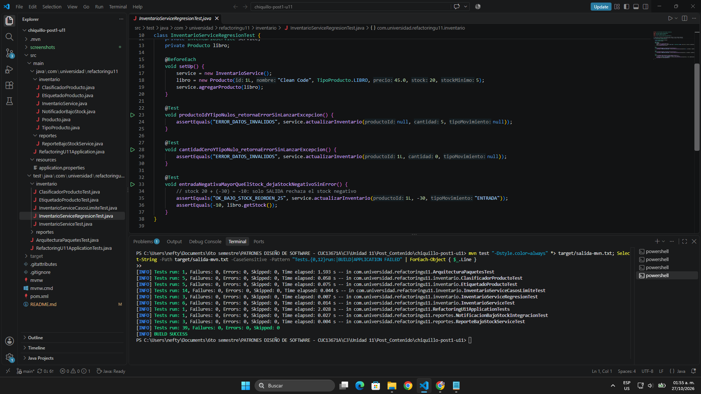

# Post-contenido — Unidad 11: Refactorización Guiada por Pruebas

## Descripción

Repositorio del post-contenido de la Unidad 11 de Patrones de Diseño de Software. Contiene un único proyecto Maven con Spring Boot (`refactoring-u11`) en la raíz, trabajado como un kata de refactorización guiada por pruebas: primero se documenta con pruebas lo que el código hace hoy y solo después se cambia su estructura, verificando en cada paso que el comportamiento observable no cambie.

El proyecto tiene dos partes: la **Parte 1** elimina dos code smells de un servicio de inventario (un Long Method y un Switch Statement duplicado en dos clases); la **Parte 2** agrega un módulo de reportes, detecta con una prueba de arquitectura la dependencia cíclica que introduce entre paquetes y la resuelve invirtiendo la dependencia.

---

## Parte 1 — Code Smells en el Servicio de Inventario

### 1. Diagnóstico con evidencia (código original)

Las líneas citadas corresponden al commit `9f5752b`, donde está el código tal como lo entrega el enunciado. Las métricas de complejidad y cobertura se midieron con JaCoCo.

#### Long Method en `InventarioService.actualizarInventario()`

El método ocupa **44 líneas** (19 a 62) y mezcla cinco responsabilidades en un solo bloque:

| Responsabilidad | Líneas | Qué hace |
|-----------------|--------|----------|
| Validación de entrada | 21-25 | Revisa `productoId`, `cantidad` y que `tipoMovimiento` sea `ENTRADA` o `SALIDA` |
| Búsqueda del producto | 27-32 | Recorre la lista con un `for` y un `break` |
| Actualización de stock | 34-42 | Suma o resta según el tipo y rechaza un stock negativo en `SALIDA` |
| Cálculo de reorden | 44-47 | `stockMinimo * 3 - nuevoStock` cuando el stock queda bajo el mínimo |
| Registro y alerta | 49-61 | Arma el texto del movimiento, lo guarda, lo imprime y decide la alerta |

- **Complejidad ciclomática: 13** según JaCoCo (la guía, sección 7.3, pone la meta en CC ≤ 10). Contando a mano sobre el código fuente salen 11 decisiones: el `if` de validación con sus tres operadores (`||`, `||`, `&&`), el `for`, los `if` de búsqueda, de producto nulo, de tipo `ENTRADA` y de stock negativo, el ternario de la reorden y el `if` de la alerta. JaCoCo suma una más porque la comparación `nuevoStock < producto.getStockMinimo()` se compila como un salto condicional.
- **Cobertura: 0 %**, porque el proyecto no traía pruebas.
- El propio método necesita comentarios de encabezado para separar sus partes, algo que la guía (sección 6.3) señala como síntoma de que el método hace demasiado.

#### Switch Statements duplicados en `ClasificadorProducto` y `EtiquetadoProducto`

Las dos clases tienen un `switch` sobre `TipoProducto` en las líneas 7-14, con las mismas cuatro ramas en el mismo orden (`LIBRO`, `ELECTRONICO`, `ROPA`, `ALIMENTO`) y el mismo `default`:

- **Duplicación estructural del 100 %**: mismas ramas, mismo orden y mismo `default`; lo único que cambia es la expresión después de cada `return`.
- **Duplicación textual del 50 %**: de las 8 líneas de cada `switch`, 4 son idénticas carácter por carácter (`switch (producto.getTipo()) {`, las dos líneas del `default` y la llave de cierre).
- **Complejidad ciclomática de 5** en `calcularRecargoEnvio` y en `generarEtiqueta`.
- **La rama `default` es código muerto**: JaCoCo la reporta sin cubrir (4 de 5 ramas) aun probando los cuatro tipos, porque con un enum de cuatro valores es inalcanzable; un producto con tipo `null` lanza `NullPointerException` en el `switch` antes de llegar a ella.
- **Riesgo de cambio (Shotgun Surgery)**: agregar un tipo de producto obliga a acordarse de editar las dos clases. Si se olvida una, el error solo aparece en ejecución, en el `default`.

### 2. Red de seguridad: pruebas de caracterización

Antes de modificar una sola línea de `InventarioService`, `ClasificadorProducto` o `EtiquetadoProducto` se escribieron las pruebas y se ejecutaron en verde sobre el código original (commit `54f5f94`). Se instancian con `new`, sin levantar Spring, para que sean rápidas.

| Clase de prueba | Pruebas | Qué documenta |
|-----------------|---------|---------------|
| `InventarioServiceTest` | 6 | Las del enunciado: OK, error de datos, error de stock, alerta de reorden y producto inexistente |
| `InventarioServiceCasosLimiteTest` | 14 | Casos límite agregados (ver abajo) |
| `ClasificadorProductoTest` | 5 | Las cuatro ramas del recargo y el tipo `null` |
| `EtiquetadoProductoTest` | 5 | Las cuatro ramas de la etiqueta y el tipo `null` |
| `RefactoringU11ApplicationTests` | 1 | Que el contexto de Spring arranque (generada por Spring Initializr) |

Las pruebas del enunciado se copiaron tal cual, pero tenían dos vacíos frente a su propio checkpoint y a la rúbrica, y se cerraron en este mismo paso:

1. **`EtiquetadoProductoTest` solo probaba `LIBRO` y `ELECTRONICO`**, mientras el checkpoint pide cubrir "las cuatro ramas del switch en ambas clases". Se agregaron `ROPA` y `ALIMENTO`.
2. **Faltaban casos límite.** `InventarioServiceCasosLimiteTest` fija: `productoId` nulo, cantidad cero, `"entrada"` en minúscula, `tipoMovimiento` nulo (lanza `NullPointerException`), que la validación ocurre antes de buscar el producto, stock que queda igual al mínimo (no hay reorden), salida de todo el stock, reorden después de una `ENTRADA`, varios productos en la lista y **lo que se imprime en consola** (registro y alerta), porque esos mensajes también son comportamiento observable y el refactor los cambia de lugar.

Dos de esas pruebas documentan un comportamiento que **no es correcto pero es el actual**: una `ENTRADA` con cantidad negativa resta stock y una `SALIDA` con cantidad negativa lo suma. Una prueba de caracterización no corrige el código, lo describe (guía, sección 7.2); arreglarlo sería un cambio de comportamiento y no le corresponde a un refactor.

Resultado: **31 pruebas, 0 fallos** sobre el código original, y `InventarioService` con el **100 % de líneas y ramas** cubiertas.


### 3. Refactorización del Long Method

Se hizo en dos commits, uno por técnica, como pide el protocolo de la guía (sección 7.1), ejecutando `mvn test` después de cada cambio:

1. **Move Method** (commit `d84dccf`): el cálculo de reorden pasó a `Producto` como `necesitaReorden()` y `calcularCantidadReorden()`. Ver *Decisión de diseño 1*.
2. **Extract Method con una guard clause** (commit `594a634`): cada responsabilidad pasó a un método privado con nombre propio, y la búsqueda devuelve un `Optional<Producto>` en lugar de un `null`, como recomienda la guía (sección 6.4).

```java
public String actualizarInventario(Long productoId, int cantidad, String tipoMovimiento) {
    if (!sonDatosValidos(productoId, cantidad, tipoMovimiento)) return "ERROR_DATOS_INVALIDOS";
    return buscarProducto(productoId)
            .map(producto -> aplicarMovimiento(producto, cantidad, tipoMovimiento))
            .orElse("ERROR_PRODUCTO_NO_EXISTE");
}
```

| Métrica | Antes | Después |
|---------|-------|---------|
| Líneas de `actualizarInventario()` | 44 | 6 |
| Complejidad ciclomática de `actualizarInventario()` | 13 | 2 |
| CC más alta entre los métodos extraídos | — | 4 (`sonDatosValidos`, `aplicarMovimiento`) |
| Responsabilidades por método | 5 | 1 |

| Método extraído | Responsabilidad |
|-----------------|-----------------|
| `sonDatosValidos` / `esTipoMovimientoValido` | Validación de entrada |
| `buscarProducto` | Búsqueda por id |
| `aplicarMovimiento` | Orquestar el movimiento sobre un producto ya encontrado |
| `calcularNuevoStock` | Sumar o restar según el tipo |
| `registrarMovimiento` | Guardar e imprimir el registro |
| `alertarReorden` | Imprimir la alerta y armar el código de respuesta |
| `Producto.necesitaReorden` / `Producto.calcularCantidadReorden` | Regla de reorden del producto |

**Un hallazgo durante el refactor:** la primera versión de `sonDatosValidos` evaluaba `tipoMovimiento.equals(...)` antes de revisar `productoId`. En el original, el `||` corta en `productoId == null`, de modo que `actualizarInventario(null, 5, null)` devuelve `ERROR_DATOS_INVALIDOS`; con el orden cambiado lanzaba `NullPointerException`. **Ninguna de las 31 pruebas cubre ese caso**, así que la suite habría seguido en verde. Se detectó revisando la equivalencia línea por línea y se corrigió respetando el orden original. Lo mismo pasa con el stock negativo: el original solo lo rechaza en `SALIDA`, y una `ENTRADA` con cantidad negativa grande deja el stock en negativo sin error; esa asimetría se conservó a propósito. Como ninguno de los dos casos tenía prueba, se agregó `InventarioServiceRegresionTest` (commit `7399847`) con ellos; sus 3 pruebas pasan también sobre el código original del commit `9f5752b`, así que documentan el comportamiento de partida y no el del refactor. La conclusión es que las pruebas de caracterización son la red de seguridad, pero no reemplazan leer el código que se está moviendo.

**Lo que se dejó igual a propósito:** la lista `movimientos` de `InventarioService` se llena en cada movimiento pero ninguna clase la lee. Viene del código original como registro de auditoría y no tiene un método que la exponga; quitarla no cambiaría lo que se ve desde afuera, pero el enunciado no pide eliminar esa responsabilidad, así que se conservó y queda señalada aquí. Tampoco se cambiaron los códigos de retorno en `String` (`"OK_30"`, `"ERROR_DATOS_INVALIDOS"`): la guía (sección 6.4) recomienda excepciones, pero son el contrato que fijan las pruebas de caracterización, y cambiarlos sería cambiar el comportamiento observable.

### 4. Refactorización del Switch Statement duplicado

Se aplicó **Replace Conditional with Polymorphism** (guía, sección 3.1) sobre el propio enum: `TipoProducto` declara un método abstracto por comportamiento y cada constante lo implementa. Las dos clases quedan delegando en el tipo, con su firma original intacta:

```java
public enum TipoProducto {
    LIBRO {
        @Override
        public double calcularRecargoEnvio(double precio) { return 0.0; }

        @Override
        public String generarEtiqueta(String nombre) { return "[LIBRO] " + nombre + " - Exento de IVA"; }
    },
    // ELECTRONICO, ROPA y ALIMENTO igual, cada uno con sus dos implementaciones
    ;
    public abstract double calcularRecargoEnvio(double precio);
    public abstract String generarEtiqueta(String nombre);
}

public double calcularRecargoEnvio(Producto producto) {        // ClasificadorProducto
    return producto.getTipo().calcularRecargoEnvio(producto.getPrecio());
}

public String generarEtiqueta(Producto producto) {             // EtiquetadoProducto
    return producto.getTipo().generarEtiqueta(producto.getNombre());
}
```

| Métrica | Antes | Después |
|---------|-------|---------|
| `switch` sobre `TipoProducto` en el proyecto | 2 (con 4 ramas cada uno) | 0 |
| CC de `calcularRecargoEnvio` / `generarEtiqueta` | 5 / 5 | 1 / 1 |
| Rama `default` inalcanzable | 2 (una por clase) | 0 |
| Clases que hay que editar para agregar un tipo | 2 (`ClasificadorProducto` y `EtiquetadoProducto`) | 1 (`TipoProducto`) |
| Si se olvida un comportamiento para un tipo nuevo | Error en ejecución, en el `default` | **No compila** |

Una búsqueda de `switch`, `case` o comparaciones con constantes de `TipoProducto` en `src/main` no devuelve ningún resultado.

Los métodos de enum reciben el precio o el nombre, no el `Producto` completo: cada comportamiento pide solo el dato que usa, y así `TipoProducto` no depende de `Producto` (la dependencia va en un solo sentido, de `Producto` hacia su tipo).

### 5. Resultado de `mvn test` en cada paso

Las pruebas no se modificaron en ningún paso: `git diff` sobre `src/test` sale vacío entre los commits `54f5f94` y `8105258`.

| Momento | Commit | Pruebas | Resultado |
|---------|--------|---------|-----------|
| Código original con las pruebas de caracterización | `54f5f94` | 31 | 31 en verde |
| Después de Move Method (reorden en `Producto`) | `d84dccf` | 31 | 31 en verde |
| Después de Extract Method (Long Method eliminado) | `594a634` | 31 | 31 en verde |
| Después de eliminar el switch duplicado | `8105258` | 31 | 31 en verde |


---

## Parte 2 — Acoplamiento entre Paquetes

### 1. Integración del módulo de reportes

Se agregó ArchUnit 1.3.0 al `pom.xml` (alcance `test`) y el paquete `reportes` con `ReporteBajoStockService`, tal como lo plantea el enunciado: recibe `InventarioService` por constructor y `InventarioService` lo recibe a él por un setter con `@Autowired(required = false)`, para avisarle desde la rama de alerta de reorden. El enunciado deja `generarReporte()` a cargo del estudiante: recorre los productos bajo el mínimo, que `InventarioService` expone con una consulta nueva, `listarProductosBajoStock()`. Esa consulta filtra con `Producto::necesitaReorden`, así que el reporte no repite la fórmula de reorden (ver *Decisión de diseño 1*).

El enunciado afirma que, después de este paso, todas las pruebas siguen en verde. **No es así.** Las 30 pruebas de caracterización pasan, porque crean `InventarioService` con `new` y nunca le asignan el colaborador, pero `RefactoringU11ApplicationTests.contextLoads` falla y la aplicación no arranca:

```text
APPLICATION FAILED TO START
Error creating bean with name 'inventarioService': Unsatisfied dependency expressed through
method 'setReporteBajoStockService' parameter 0: Error creating bean with name 'reporteBajoStockService':
Unsatisfied dependency expressed through constructor parameter 0: Error creating bean with name
'inventarioService': Requested bean is currently in creation: Is there an unresolvable circular reference?
Relying upon circular references is discouraged and they are prohibited by default.
```

Además del ciclo entre **paquetes**, que es el que pide diagnosticar el enunciado, hay un ciclo entre **objetos**: para crear `InventarioService`, Spring necesita `ReporteBajoStockService`, y para crear ese bean necesita el `InventarioService` que todavía no termina de construirse. Desde Spring Boot 2.6 las referencias circulares están prohibidas por defecto. Este estado se dejó así en el commit del módulo, igual que el enunciado lo plantea, para que el historial muestre el problema; su solución está más adelante.

### 2. Diagnóstico con una prueba de arquitectura

`ArquitecturaPaquetesTest` usa `slices().matching("com.universidad.refactoringu11.(*)..").should().beFreeOfCycles()`, que trata cada subpaquete como un bloque y falla si dos bloques dependen uno del otro. Ejecutada con `mvn test -Dtest=ArquitecturaPaquetesTest`, **falla** y ArchUnit detalla el ciclo:

```text
Architecture Violation [Priority: MEDIUM] - Rule 'slices matching 'com.universidad.refactoringu11.(*)..'
should be free of cycles' was violated (1 times):
Cycle detected: Slice inventario ->
                Slice reportes ->
                Slice inventario
  1. Dependencies of Slice inventario
    - Field <InventarioService.reporteBajoStockService> has type <ReporteBajoStockService>
    - Method <InventarioService.setReporteBajoStockService(ReporteBajoStockService)> has parameter of type <ReporteBajoStockService>
    - Method <InventarioService.alertarReorden(Producto)> calls method <ReporteBajoStockService.generarReporte()> in (InventarioService.java:77)
  2. Dependencies of Slice reportes
    - Constructor <ReporteBajoStockService.<init>(InventarioService)> has parameter of type <InventarioService>
    - Field <ReporteBajoStockService.inventarioService> has type <InventarioService>
    - Method <ReporteBajoStockService.generarReporte()> calls method <InventarioService.listarProductosBajoStock()> in (ReporteBajoStockService.java:19)
    - ... y 4 llamadas más a getters y métodos de Producto (líneas 24-27)
```

*(Salida recortada: se quitó el nombre completo del paquete `com.universidad.refactoringu11` en cada clase para que se lea mejor.)*

Diagrama de paquetes **antes**, con las dos flechas en sentidos opuestos:



Al mismo tiempo, las 30 pruebas de caracterización de la Parte 1 siguen en verde y sin modificar: el ciclo no cambia lo que hace `actualizarInventario()`, así que es un problema de arquitectura y no de comportamiento. Un code smell no es un bug, y por eso hizo falta una prueba distinta para verlo.

| Prueba | Resultado en este punto |
|--------|-------------------------|
| 30 pruebas de caracterización (Parte 1) | En verde |
| `ArquitecturaPaquetesTest` | **En rojo:** ciclo `inventario -> reportes -> inventario` |
| `RefactoringU11ApplicationTests.contextLoads` | **En rojo:** referencia circular entre beans |



### 3. Resolución del ciclo de paquetes: inversión de dependencia

En el commit `dbba1a1` se aplicó el principio de Inversión de Dependencias (guía, sección 5.1). Se extrajo la interfaz `NotificadorBajoStock` en el paquete `inventario`:

```java
public interface NotificadorBajoStock {
    void notificar(Producto producto, int cantidadReorden);
}
```

- `InventarioService` dejó de importar `ReporteBajoStockService`: ahora guarda un `NotificadorBajoStock` (sigue llegando por setter, para no cambiar el constructor que usan las pruebas) y en la rama de reorden llama a `notificador.notificar(producto, cantidadReorden)`.
- `ReporteBajoStockService` implementa la interfaz. Como el enunciado sugiere, `notificar()` registra la alerta y `generarReporte()` arma el texto con las alertas recibidas. Por eso `listarProductosBajoStock()` dejó de hacer falta y se eliminó de `InventarioService`.
- Una búsqueda de `reportes` dentro del paquete `inventario` no devuelve nada.
- El enunciado deja el notificador en `null` y lo revisa con `if (notificador != null)` en cada alerta, porque las pruebas de la Parte 1 crean `InventarioService` con `new` y nunca le asignan uno. En el commit `cf79001` se cambió por un **notificador nulo** (`SIN_NOTIFICADOR`, una implementación que no hace nada) como valor por defecto, y el setter rechaza `null` con `Objects.requireNonNull`. Así desaparece la verificación y no hay ningún `null` que pasar de un lado a otro (guía, sección 6.4).

`mvn test -Dtest=ArquitecturaPaquetesTest` pasó a verde:

```text
[INFO] Tests run: 1, Failures: 0, Errors: 0, Skipped: 0 -- in com.universidad.refactoringu11.ArquitecturaPaquetesTest
[INFO] BUILD SUCCESS
```

### 4. El ciclo que ArchUnit no ve: dependencia entre beans

Con la inversión hecha tal como la plantea el enunciado, ArchUnit queda en verde, pero **la aplicación sigue sin arrancar**. `ReporteBajoStockService` conservaba en su constructor el `InventarioService` del Paso 1, y Spring seguía teniendo que crear cada bean antes que el otro: `InventarioService` necesita un `NotificadorBajoStock` para su setter, y el único que existe es `ReporteBajoStockService`, que pide `InventarioService` para construirse. Lo más llamativo es que ese campo **ya no se usaba**: después de la inversión, el reporte se arma con las alertas que recibe, y el propio IDE lo marcaba como "not used".



ArchUnit revisa dependencias entre **tipos**, y a ese nivel `reportes -> inventario` es una dirección permitida. El ciclo estaba en el grafo de **objetos** que arma Spring, y solo una prueba que levante el contexto (`contextLoads`) lo detecta. Una prueba de arquitectura en verde no garantiza que la aplicación funcione.

**Solución (commit `6ba4dc8`):** se eliminó la dependencia sin uso. `ReporteBajoStockService` quedó sin constructor con parámetros, y su única relación con `inventario` es implementar `NotificadorBajoStock` y leer los datos del `Producto` que recibe. Se descartaron dos alternativas que también hacen arrancar la aplicación:

- **`@Lazy` en el parámetro del constructor:** Spring inyecta un proxy y crea el bean real después. El ciclo sigue existiendo, solo que escondido, y el campo seguiría sin usarse.
- **`spring.main.allow-circular-references=true`:** el propio mensaje de Spring lo describe como "último recurso", y apaga la protección para todo el proyecto, no solo para este caso.

Además se agregaron pruebas para el módulo de reportes, que no tenía ninguna:

| Clase de prueba | Pruebas | Qué verifica |
|-----------------|---------|--------------|
| `ReporteBajoStockServiceTest` | 3 | Reporte sin alertas, registro de una alerta y que `InventarioService` avisa al reporte solo cuando un producto queda bajo el mínimo |
| `NotificacionBajoStockIntegracionTest` | 1 | Con `@SpringBootTest`, que Spring conecta de verdad el reporte como notificador del inventario. Con `@Autowired(required = false)`, si esa conexión fallara, las alertas se perderían sin ningún error |

### 5. Diagrama de paquetes después

Mismo diagrama que el de antes, con los dos paquetes, pero ahora con una sola flecha:



Queda una sola flecha entre paquetes, de `reportes` hacia `inventario`: el módulo de reportes depende del dominio y el dominio no sabe que los reportes existen.

| Dirección | Antes | Después |
|-----------|-------|---------|
| `inventario -> reportes` | 3 dependencias (campo, setter y llamada a `generarReporte()`) | 0 |
| `reportes -> inventario` | 7 dependencias (constructor, campo, `listarProductosBajoStock()` y 4 de `Producto`) | Implementa `NotificadorBajoStock` y usa `Producto` |
| Ciclo entre beans de Spring | Sí, la aplicación no arranca | No |

Estructura final del proyecto:

```text
chiquillo-post1-u11/
├── pom.xml                                       ← incluye ArchUnit
├── README.md
├── screenshots/
│   ├── p1/                                       ← evidencias Parte 1
│   └── p2/                                       ← evidencias Parte 2
└── src/
    ├── main/java/com/universidad/refactoringu11/
    │   ├── RefactoringU11Application.java
    │   ├── inventario/                           ← dominio
    │   │   ├── TipoProducto.java                 ← polimorfismo por tipo
    │   │   ├── Producto.java                     ← regla de reorden
    │   │   ├── InventarioService.java            ← método ya descompuesto
    │   │   ├── ClasificadorProducto.java         ← delega en el tipo
    │   │   ├── EtiquetadoProducto.java           ← delega en el tipo
    │   │   └── NotificadorBajoStock.java         ← interfaz (DIP)
    │   └── reportes/                             ← nuevo en Parte 2
    │       └── ReporteBajoStockService.java      ← implementa la interfaz
    └── test/java/com/universidad/refactoringu11/
        ├── ArquitecturaPaquetesTest.java         ← ArchUnit
        ├── RefactoringU11ApplicationTests.java   ← contextLoads
        ├── inventario/                           ← caracterización y regresión
        │   ├── InventarioServiceTest.java
        │   ├── InventarioServiceCasosLimiteTest.java
        │   ├── InventarioServiceRegresionTest.java
        │   ├── ClasificadorProductoTest.java
        │   └── EtiquetadoProductoTest.java
        └── reportes/                             ← pruebas del reporte
            ├── ReporteBajoStockServiceTest.java
            └── NotificacionBajoStockIntegracionTest.java
```

### 6. Resultado final de las pruebas

| Momento | Commit | Caracterización (30) | ArchUnit | `contextLoads` | Total |
|---------|--------|----------------------|----------|----------------|-------|
| Módulo de reportes agregado | `4b67cb0` | En verde | — | **En rojo** | 30 de 31 |
| Prueba de arquitectura agregada | `db2519d` | En verde | **En rojo** | **En rojo** | 30 de 32 |
| Inversión de dependencia | `dbba1a1` | En verde | En verde | **En rojo** | 31 de 32 |
| Dependencia sin uso eliminada | `6ba4dc8` | En verde | En verde | En verde | 36 de 36 |
| Pruebas de regresión agregadas | `7399847` | En verde | En verde | En verde | 39 de 39 |
| Notificador nulo en lugar de `null` | `cf79001` | En verde | En verde | En verde | **39 de 39** |

Las 30 pruebas de caracterización de la Parte 1 se ejecutaron en todos estos momentos **sin modificar ni una línea**: `git diff --diff-filter=M 54f5f94 -- src/test` no muestra ningún archivo modificado (solo aparecen como agregados los archivos de prueba nuevos).

El enunciado espera `Tests run: 12` al final, que corresponde solo a sus pruebas originales (6 + 4 + 2). Aquí son 39 porque se sumaron las 18 pruebas de caracterización agregadas en el Paso 2 de la Parte 1, las 3 de regresión, `contextLoads`, la prueba de arquitectura y las 4 del módulo de reportes.



---

## Cómo ejecutar

Requisitos: Java 17 o superior y Maven 3.9+ (o el wrapper incluido).

```bash
mvn test                                    # suite completa
mvn test -Dtest=InventarioServiceTest       # una sola clase de prueba
mvn test -Dtest=ArquitecturaPaquetesTest    # solo la prueba de arquitectura (ciclos entre paquetes)
```

> En Windows con el wrapper: `.\mvnw.cmd test`.

Para reproducir las métricas de complejidad y cobertura citadas en este README (reporte en `target/site/jacoco/index.html`):

```bash
mvn clean org.jacoco:jacoco-maven-plugin:0.8.12:prepare-agent test org.jacoco:jacoco-maven-plugin:0.8.12:report
```

---

## Herramientas utilizadas

- Java 17, Spring Boot 4.1.2 (Spring Boot Starter), JUnit 5
- JaCoCo 0.8.12 (complejidad ciclomática y cobertura)
- ArchUnit 1.3.0 (prueba de arquitectura para detectar ciclos entre paquetes)
- Apache Maven, Git, GitHub, Visual Studio Code

---

## Decisiones de diseño

### Decisión de diseño 1 — Cálculo de la cantidad de reorden: ¿método privado o clase propia?

**Decisión:** ninguna de las dos. El cálculo pasó a la propia entidad `Producto`, con **Move Method** (guía, sección 2.3): `producto.necesitaReorden()` y `producto.calcularCantidadReorden()`. `InventarioService` solo pregunta y no calcula.

**Por qué:** la fórmula `stockMinimo * 3 - stock` usa únicamente datos de `Producto` (su stock y su stock mínimo) y ningún dato del servicio. En el original, `InventarioService` leía dos veces `producto.getStockMinimo()` y lo combinaba con el stock que acababa de asignarle al mismo producto, es decir, calculaba por fuera algo que es del producto: es **Feature Envy**, y la guía da como criterio que, si la mayoría de las referencias de un método son a otra clase, ese método pertenece a esa otra clase. Es el mismo criterio que deja la regla en la entidad cuando no necesita ningún colaborador externo (repositorio, otro servicio, configuración).

**Alternativas descartadas:**

- **Método privado en `InventarioService`:** quita líneas del método largo, pero deja la regla en el lugar equivocado. El servicio seguiría pidiéndole datos a `Producto` para hacer el cálculo por fuera, y cualquier otra clase que necesitara saber si un producto requiere reorden (por ejemplo, el módulo de reportes de la Parte 2) tendría que duplicar la fórmula o pasar por el servicio.
- **Clase `CalculadoraReorden`:** se justificaría si la política de reorden tuviera una razón de cambio propia, por ejemplo si dependiera del proveedor o de una configuración. Hoy es una sola expresión sin colaboradores, así que una clase solo para eso sería una **Lazy Class** y una abstracción para un caso que no existe (**Speculative Generality**, guía, sección 1.4).

**Lo que se sacrifica:** si mañana la política de reorden dependiera de algo externo (un proveedor, un parámetro de configuración), ya no cabría en `Producto`, porque la entidad no debe conocer servicios. En ese momento sí convendría extraer una clase. Mientras sea una regla del propio producto, su lugar es la entidad.

### Decisión de diseño 2 — Mecanismo de polimorfismo: ¿enum con métodos abstractos o interfaz Strategy?

**Decisión:** enum con un método abstracto por comportamiento (`calcularRecargoEnvio` y `generarEtiqueta`), implementado en cada constante de `TipoProducto`. **Alternativa descartada:** una interfaz de estrategia con una clase por tipo de producto.

**Justificación:** (1) el conjunto de tipos es cerrado y estable en este dominio: `TipoProducto` ya era un enum de cuatro valores y lo que cambia por tipo es una función pura del precio o del nombre, sin datos externos; (2) el compilador obliga a que toda constante nueva implemente los dos métodos abstractos, de modo que olvidar un comportamiento ya no es un error en ejecución en el `default` sino un error de compilación; (3) agregar un tipo toca un solo archivo, `TipoProducto`, y ni `ClasificadorProducto` ni `EtiquetadoProducto` cambian, que es la condición no negociable del Paso 4. Con Strategy habría hecho falta una interfaz, cuatro clases como mínimo y además un `Map` o registro que relacione cada `TipoProducto` con su estrategia, y ese registro sería un tercer lugar que actualizar por cada tipo nuevo.

**Lo que se sacrifica:** las constantes de un enum no pueden recibir beans de Spring por inyección. Si en el futuro un tipo necesitara un colaborador (por ejemplo, consultar una tarifa de envío en un servicio externo), habría que migrar a la interfaz Strategy con una clase `@Component` por tipo, y ese costo de una jerarquía adicional se pagaría entonces. Además, `ClasificadorProducto` y `EtiquetadoProducto` quedan como clases de una sola línea que delegan en el tipo, cerca de un **Middle Man** (guía, sección 1.5). Se conservan porque el checkpoint exige mantener sus firmas y porque son el punto de entrada que ya usan sus pruebas; si nadie más las necesitara, el siguiente paso sería llamar directamente a `producto.getTipo()`.

### Decisión de diseño 3 — Ubicación de `NotificadorBajoStock`: ¿en `inventario` o en `reportes`?

**Decisión:** la interfaz vive en `inventario`. **Alternativa descartada:** ponerla en `reportes`, junto a su única implementación.

**¿Cuál es el paquete de mayor nivel de abstracción?** `inventario`. Contiene las reglas del negocio (cómo se mueve el stock, cuándo un producto necesita reorden y cuánto pedir) y no depende de cómo se presente esa información. `reportes` es un consumidor de esos eventos: decide el formato del texto y cómo se acumulan las alertas, y eso cambia más seguido (un correo, un PDF, un tablero). Aplicando la regla de la guía (sección 4.3), "los paquetes de infraestructura dependen de dominio; dominio nunca depende de infraestructura", `reportes` hace el papel de infraestructura frente a `inventario`.

**Justificación:** (1) la interfaz describe lo que **necesita** `InventarioService` ("avísenme cuando un producto quede bajo el mínimo"), así que pertenece a quien la usa y no a quien la implementa; esa es la "inversión" del principio: el detalle se adapta al contrato del dominio y no al revés; (2) si la interfaz estuviera en `reportes`, `inventario` tendría que importarla y el ciclo seguiría ahí, solo que con una interfaz en lugar de una clase, y `ArquitecturaPaquetesTest` seguiría en rojo; (3) con la interfaz en `inventario` se puede agregar otro notificador (correo, cola de mensajes) en un paquete nuevo sin tocar `inventario`.

La guía, en la misma sección 4.3, dice "introducir una interfaz en el paquete de **menor** nivel de abstracción". Leída literalmente, esa frase llevaría la interfaz a `reportes` y no rompería el ciclo, y contradice la regla práctica que aparece justo debajo. Aquí se siguió la regla práctica y el enunciado ("esa abstracción debe vivir junto al paquete de mayor nivel"), y la prueba de arquitectura confirma que esa es la ubicación que elimina el ciclo.

**Lo que se sacrifica:** `inventario` define un contrato para un módulo que no conoce. Si los reportes necesitaran un dato nuevo (por ejemplo, la fecha del movimiento), habría que cambiar la interfaz en el dominio y no solo en `reportes`.

### Decisión de diseño 4 — Granularidad de `NotificadorBajoStock`: ¿por evento o por lote?

**Decisión:** un método por evento individual, `notificar(Producto producto, int cantidadReorden)`, que se llama cada vez que un movimiento deja un producto bajo el mínimo. **Alternativa descartada:** un método por lote, por ejemplo `notificar(List<Producto> productos)`.

**Ventajas de la notificación por evento en este diseño:** (1) coincide con el momento en que `InventarioService` detecta el problema: cada llamada a `actualizarInventario()` mueve un solo producto, y la alerta sale en `alertarReorden()` sin que el servicio tenga que acumular nada; con un lote, el servicio necesitaría una lista de pendientes y decidir cuándo enviarla, una responsabilidad y un estado nuevos; (2) el evento lleva la `cantidadReorden` ya calculada por `Producto`, así que el receptor no tiene que volver a calcularla y la fórmula sigue en un solo lugar (ver *Decisión de diseño 1*); (3) cada llamada es una alerta, lo que hace las pruebas directas: una salida bajo el mínimo produce exactamente una línea en el reporte.

**Cuándo se preferiría un lote:** cuando notificar es costoso o molesto por cada evento. Por ejemplo, si el notificador enviara un correo o llamara a la API de un proveedor, una carga masiva de inventario o un cierre de día con cientos de salidas generaría cientos de mensajes, y convendría juntar los productos bajo el mínimo y enviar un solo resumen. También en un reporte programado (por ejemplo, uno nocturno) que muestre el estado al final del día y no cada movimiento.

**Lo que se sacrifica:** como cada evento se registra por separado, si el mismo producto baja del mínimo en dos salidas seguidas, el reporte muestra dos alertas para él. El reporte es un historial de alertas y no una foto del estado actual del inventario; para lo que pide el enunciado ("registrar la alerta para incluirla en el próximo reporte") es suficiente.

---

## Conclusiones

La Parte 1 mostró que escribir las pruebas antes de tocar el código no es un trámite: con ellas en verde se bajó `actualizarInventario()` de 44 líneas y CC 13 a 6 líneas y CC 2, y se quitaron los dos `switch`, sin modificar ni una prueba. Las dos decisiones salieron de preguntar a quién le pertenece cada dato, y el caso `(null, 5, null)` dejó claro que las pruebas solo protegen lo que cubren, por eso terminó con su propia prueba de regresión.

La Parte 2 mostró que un problema de diseño puede pasar todas las pruebas de negocio: el ciclo entre `inventario` y `reportes` solo se vio con ArchUnit, y se resolvió dejando `NotificadorBajoStock` en el dominio. La lección más fuerte fue que ArchUnit en verde no significaba que la aplicación arrancara: quedaba un ciclo entre beans por una dependencia que ni se usaba, y solo `contextLoads` lo detectó.

En general, cada tipo de prueba vio un nivel distinto del sistema (comportamiento, paquetes y objetos de Spring) y ninguna sola habría bastado. También quedó claro que el código de referencia no se puede copiar sin revisarlo: encontrar sus huecos fue parte del trabajo tanto como aplicar las técnicas.
